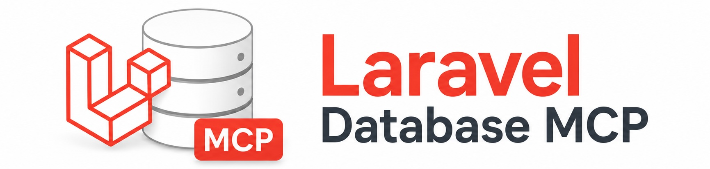

<p align="center">
  <picture>
    <source media="(prefers-color-scheme: dark)" srcset="branding/logo-dark.jpg">
    <source media="(prefers-color-scheme: light)" srcset="branding/logo-light.jpg">
    
  </picture>
</p>

# Laravel Database MCP

[](https://packagist.org/packages/datomatic/laravel-database-mcp)
[](https://packagist.org/packages/datomatic/laravel-database-mcp)
[](https://github.com/datomatic/laravel-database-mcp/actions/workflows/ci.yml)

A read-only [MCP](https://modelcontextprotocol.io) server that lets an AI assistant
(Claude Code, Cursor, …) explore and query your Laravel application's database through safe,
structured parameters — **never raw SQL**.

| Tool | Purpose |
|------|---------|
| `describe_database` | Discover tables, columns, types and relationships |
| `query_database` | Read rows with joins, filters, sorting, aggregations and pagination |

## Contents

- [Use cases](#use-cases)
- [Requirements](#requirements)
- [Quick start](#quick-start)
- [Debugging locally with production data](#debugging-locally-with-production-data)
- [Security model](#security-model)
- [Configuration](#configuration)
  - [Read-only connection](#read-only-connection)
  - [Authentication and authorization](#authentication-and-authorization)
  - [Route registration](#route-registration)
  - [Restricting tables and columns](#restricting-tables-and-columns)
  - [Masking columns](#masking-columns)
  - [Multi-tenant applications](#multi-tenant-applications)
  - [Describing your schema](#describing-your-schema)
  - [Views](#views)
  - [Query timeout](#query-timeout)
  - [Audit log](#audit-log)
  - [All options](#all-options)
- [Tools reference](#tools-reference)
  - [`describe_database`](#describe_database)
  - [`query_database`](#query_database)
  - [Filters](#filters)
  - [Joins](#joins)
  - [Aggregations and grouping](#aggregations-and-grouping)
  - [Pagination](#pagination)
- [Testing](#testing)
- [License](#license)

## Use cases

- **Answer business questions** — "how many orders were paid last month?", "which customers
  haven't ordered since January?" — without writing SQL or building an admin page.
- **Debug locally with production data** — keep coding on your machine while the assistant reads
  the real production rows behind a bug report, read-only and with personal data masked. See
  [Debugging locally with production data](#debugging-locally-with-production-data).
- **Give the assistant schema awareness** — while writing code, it can check real column names,
  types, foreign keys and sample values instead of guessing them from migrations.
- **Share data access safely** — let teammates query the database through their AI client, with
  allow/deny lists, masking, tenant scoping and an audit trail.

## Requirements

- PHP 8.3+
- Laravel 12.41.1+ or 13
- `laravel/mcp` 1.0+
- MySQL, MariaDB, PostgreSQL, SQLite or SQL Server

Upgrading from 0.x? See [UPGRADE.md](UPGRADE.md) and the [changelog](CHANGELOG.md).

## Quick start

**1. Install the package.** The service provider is auto-discovered.

```bash
composer require datomatic/laravel-database-mcp
```

Optionally publish the config:

```bash
php artisan vendor:publish --tag=database-mcp-config
```

**2. Use a read-only database user** (recommended in production and shared environments,
optional locally) — see [Read-only connection](#read-only-connection).

```dotenv
DATABASE_MCP_CONNECTION=mysql_readonly
```

**3. Decide who may access the server** — in a service provider:

```php
use Illuminate\Support\Facades\Gate;

Gate::define('access-database-mcp', fn ($user) => $user->isSuperAdmin());
```

Without this gate, access is allowed in the `local` environment only.

**4. Register the server in your MCP client**, using a project-specific name. The route is
protected by `auth:sanctum` by default, so pass a token (see the
[authentication guide](docs/authentication.md) for Sanctum and Passport/OAuth):

```bash
claude mcp add acme-db --transport http https://acme.test/database-mcp \
  --header "Authorization: Bearer <token>"
```

Then ask: *"Which tables hold orders? Show me the last 10 paid ones."*

The assistant typically works in three steps:

1. `describe_database` with no arguments → available tables and relationships.
2. `describe_database` with a `table` → columns and foreign keys.
3. `query_database` with the correct table, column and `on` names.

## Debugging locally with production data

Many bugs only show up with real data: an unexpected `null`, an order in a state that "can't
happen", a customer with 3,000 addresses. With this package you can keep working on your local
codebase while the assistant inspects the production rows involved — without copying a dump to
your laptop and without write access.

### Recommended setup: connect to the production server

Install the package in production too, then register **both** servers in your local MCP client:

```bash
# Your local database
claude mcp add acme-local --transport http https://acme.test/database-mcp

# Production, read-only, authenticated with your personal token
claude mcp add acme-prod --transport http https://acme.com/database-mcp \
  --header "Authorization: Bearer <your-production-token>"
```

Now the assistant can read the code, look up the production record from the bug report and
compare it with your local data:

> *"Order A-10293 fails to generate the invoice in production. Check its row and its items on
> acme-prod, compare with a working order, and find out why `InvoiceService` throws."*

On the production side:

- **Use a [read-only database user](#read-only-connection)** — ideally on a read replica, so
  heavy queries never touch the primary.
- **Restrict the [gate](#authentication-and-authorization)** to the developers who need it.
- **[Mask](#masking-columns) or [deny](#restricting-tables-and-columns) personal data** — the
  assistant can still filter on a searchable email, count and correlate rows, without reading
  the values in clear.
- **Enable the [audit log](#audit-log)** to keep track of who read what.
- **Keep the token out of version control** — `claude mcp add` stores the server in your private
  local scope by default; don't put production tokens in a committed `.mcp.json`.

### Alternative: point your local app at a production replica

If you can't deploy the package to production, run it locally against a read-only production
connection (e.g. a replica reached through an SSH tunnel):

```dotenv
DATABASE_MCP_CONNECTION=production_readonly
```

This puts production credentials on your machine and bypasses the production-side audit log,
so prefer the setup above whenever possible.

## Security model

Defence is layered. From outermost to innermost:

0. **Authentication + authorization.** The route is protected by the configured middleware and an
   authorization gate (see [Authentication and authorization](#authentication-and-authorization)).
1. **Read-only database connection.** All reads run through `config('database-mcp.connection')`.
   Point it at a database user with `SELECT`-only grants and the assistant physically cannot
   write — the only guarantee that does not rely on application logic.
2. **No raw SQL.** Tools accept structured parameters only; nothing is interpolated into SQL.
3. **Identifiers validated against the live schema.** Every table must appear, by its exact name,
   in the listing of allowed tables, and every column must exist and survive the deny lists, or
   the request is rejected before a query runs. Schema-qualified (`otherdb.secrets`) or
   differently-cased names are rejected.
4. **Table allow/deny lists.** Auth tokens, sessions, jobs, cache, migrations, notifications,
   Telescope and Pulse are never exposed (configurable via `denied_tables`). Optionally restrict
   exposure to an explicit allowlist (`allowed_tables`).
5. **Column deny list.** `password`, `two_factor_recovery_codes`, `*_token` and `*_secret` are
   stripped from every result and description, even on a wildcard select (configurable via
   `denied_columns`, globally or per table).
6. **Column masking.** Columns the assistant may use but not read in clear are anonymised
   (`masked_columns`), and the operations that could reconstruct them are blocked.
7. **Tenant scoping.** In a single-database multi-tenant app, every query can be restricted to the
   current tenant (`tenant`).
8. **Row cap.** Results are limited (`max_limit`, default 100).
9. **Query timeout.** Each query is capped (`query_timeout`, default 10 seconds) on MySQL, MariaDB
   and PostgreSQL.
10. **Audit log.** Optionally log every tool call with the user, arguments and outcome (`audit_log`).

The tools only expose tables in the connection's own schema: the database on MySQL/MariaDB, the
`search_path` on PostgreSQL, `main` on SQLite.

## Configuration

All options live in `config/database-mcp.php`. When you publish it, only the keys you set
override the package defaults. The full list is in [All options](#all-options).

Set a project-specific name so the same package reused across projects stays distinguishable:

```dotenv
MCP_DATABASE_NAME="Acme Database"
```

### Read-only connection

When `connection` is `null` the application's default connection is used, which can write.
The package itself only ever runs `SELECT` statements, but a database user with `SELECT`-only
grants is the one guarantee that does not depend on application code: even a bug, a
misconfigured route or a vulnerable dependency cannot modify data.

- **Production and shared environments:** recommended. Point it at a read replica when you have
  one, so heavy queries never reach the primary.
- **Local or disposable databases:** optional; the default connection is fine.

**1. Create the user:**

```sql
CREATE USER 'app_readonly'@'%' IDENTIFIED BY 'a-strong-password';
GRANT SELECT ON your_database.* TO 'app_readonly'@'%';
FLUSH PRIVILEGES;
```

For sensitive data you can go one step further and grant only the tables you expose, so the
database enforces your allowlist too, not just the package:

```sql
GRANT SELECT ON your_database.orders TO 'app_readonly'@'%';
GRANT SELECT ON your_database.order_items TO 'app_readonly'@'%';
GRANT SELECT ON your_database.products TO 'app_readonly'@'%';
```

Keep these grants in sync with `allowed_tables`: a table you expose but forget to grant makes the
tool call fail, and new tables need a new `GRANT` after each migration that adds them.

**2. Define the connection** in `config/database.php`, next to `mysql`. Write it out in full:
`config()` cannot read `database.connections.mysql` from inside `config/database.php`, because
that file is still being loaded.

```php
'mysql_readonly' => [
    'driver' => 'mysql',
    'url' => env('DB_READONLY_URL'),
    'host' => env('DB_HOST', '127.0.0.1'),
    'port' => env('DB_PORT', '3306'),
    'database' => env('DB_DATABASE', 'laravel'),
    'username' => env('DB_READONLY_USERNAME'),
    'password' => env('DB_READONLY_PASSWORD'),
    'unix_socket' => env('DB_SOCKET', ''),
    'charset' => env('DB_CHARSET', 'utf8mb4'),
    'collation' => env('DB_COLLATION', 'utf8mb4_unicode_ci'),
    'prefix' => '',
    'prefix_indexes' => true,
    'strict' => true,
    'engine' => null,
    'options' => extension_loaded('pdo_mysql') ? array_filter([
        PDO::MYSQL_ATTR_SSL_CA => env('MYSQL_ATTR_SSL_CA'),
    ]) : [],
],
```

**3. Point the package at it:**

```dotenv
DATABASE_MCP_CONNECTION=mysql_readonly
DB_READONLY_USERNAME=app_readonly
DB_READONLY_PASSWORD=a-strong-password
```

### Authentication and authorization

**Authentication.** The route uses **Laravel Sanctum** (`auth:sanctum`) by default. For a
different guard — for example **Laravel Passport** (`auth:api`) — override `middleware`:

```php
// config/database-mcp.php
return [
    'middleware' => ['auth:api'],
];
```

See the [authentication guide](docs/authentication.md) for step-by-step setup of Sanctum or
Passport (OAuth 2.1), for both new and existing applications.

**Authorization.** The route is also guarded by the gate named in `config('database-mcp.gate')`
(default `access-database-mcp`), applied as `can:` middleware:

```php
use Illuminate\Support\Facades\Gate;

Gate::define('access-database-mcp', fn ($user) => $user->isSuperAdmin());
```

If you never define the gate, the package falls back to allowing **local environments only**
(everyone else gets a `403`). Set `gate` to `null` to disable the check entirely.

### Route registration

By default the server is registered over HTTP at `config('database-mcp.path')` with the
configured middleware. To register it yourself, set `register_route` to `false` and add it to
`routes/ai.php`:

```php
use Datomatic\LaravelDatabaseMcp\Servers\DatabaseServer;
use Laravel\Mcp\Facades\Mcp;

Mcp::web('database-mcp', DatabaseServer::class)
    ->middleware(['auth:sanctum', 'can:access-database-mcp']);
```

### Restricting tables and columns

Both deny lists, and the optional allowlist, accept `*` wildcards (matching is case-sensitive). A
denied column is either a bare pattern applied to every table, or a `table.column` pattern scoped
to matching tables:

```php
// config/database-mcp.php
return [
    // Only these tables are visible (the deny list still applies on top).
    'allowed_tables' => ['orders', 'order_items', 'products', 'report_*'],

    'denied_tables' => ['telescope_*', 'pulse_*', 'sessions', /* ... */],

    'denied_columns' => [
        'password',
        '*_token',            // every table
        'users.email',        // only on users
        'customers.*_iban',   // only on customers
    ],
];
```

Defaults:

- `denied_tables`: `cache`, `cache_locks`, `failed_jobs`, `job_batches`, `jobs`, `migrations`,
  `notifications`, `oauth_*`, `password_reset_tokens`, `password_resets`, `personal_access_tokens`,
  `pulse_*`, `sessions`, `telescope_*`, `webhook_calls`.
- `denied_columns`: `password`, `two_factor_recovery_codes`, `*_token`, `*_secret`.

> [!IMPORTANT]
> Setting `denied_tables` or `denied_columns` in your own config **replaces** the package
> defaults rather than extending them — copy the defaults over and add your own entries.

A denied table is hidden everywhere: it is not listed, cannot be described, queried or joined, and
foreign keys pointing at it are dropped from `describe_database`.

### Masking columns

Denying a column hides it completely. Masking keeps it usable but anonymises its value in every
result — useful for personal data the assistant needs to reason about without reading it.

```php
// config/database-mcp.php
return [
    'masked_columns' => [
        'users.email'        => ['strategy' => 'email', 'searchable' => true],
        'phone'              => 'partial',
        'customers.tax_code' => 'hash',
        'users.lastname'     => 'redact',
    ],
];
```

Keys use the same patterns as `denied_columns` (bare `column`, `table.column`, `*` wildcards); the
first matching entry wins, and a denied column stays denied. The value is a strategy name or an
array with `strategy`, `searchable` and `visible`.

#### Strategies

| Strategy | Example output | Notes |
|----------|----------------|-------|
| `redact` | `***` | The value is fully hidden |
| `partial` | `*******567` | Keeps the last `visible` characters (default 4), never more than a third of the value |
| `email` | `m***@acme.it` | Keeps the first character and the domain |
| `hash` | `a3f9c1e2b4d70f18` | Stable pseudonym: an HMAC keyed with `mask_key` (or `APP_KEY`), so the same value always gives the same token and rows can be counted or correlated without the real value |

`null` values stay `null`. An unknown strategy falls back to `redact`, so a typo never exposes data.

#### What the assistant can do with a masked column

Any operation that could rebuild the value is rejected:

| | Allowed | Rejected |
|---|---|---|
| Select | yes, value masked | — |
| Filters | `is_null`, `is_not_null`; `=` only if `searchable` | every other operator (`like`, `starts_with`, `in`, `between`, `>`…) |
| Sorting | — | `order_by`, `sort` |
| Aggregates | `COUNT`, `COUNT(DISTINCT)` | `MIN`, `MAX`, `SUM`, `AVG` |
| `group_by` / `having` | — | always |

#### Searchable columns

A searchable column accepts `=` with the full exact value, so the assistant can find a record from
a value the user already knows — e.g. "show the orders of mario@acme.it" — while every result
keeps the email masked:

```json
{
  "table": "orders",
  "columns": ["code", "total"],
  "joins": [ { "table": "users", "on": "user_id", "columns": ["email"] } ],
  "filters": [ { "column": "users.email", "operator": "=", "value": "mario@acme.it" } ]
}
```

An exact match can confirm that a value exists, but cannot reveal values the caller does not
already know. Keep `searchable` off for low-entropy columns (phone numbers, tax codes, postcodes),
where values could be guessed one by one; the [audit log](#audit-log) helps spot such attempts.

`describe_database` flags masked columns so the assistant knows what to expect:

```json
{ "name": "email", "type": "varchar", "nullable": false, "default": null, "masked": "email", "searchable": true }
```

#### Limits

- Masking protects individual columns. It does not help with free-text columns (`notes`,
  `address`) that may contain personal data anywhere — deny those instead.
- It does not prevent re-identification through combinations of harmless columns (birth date +
  postcode + gender).
- The `hash` strategy cannot be searched by token, since computing it would require the key
  inside the database; correlate pseudonymised rows through their ids and foreign keys instead.
- Rotating `APP_KEY` changes every pseudonym; set a dedicated `DATABASE_MCP_MASK_KEY` to keep
  them stable.

### Multi-tenant applications

In a single-database multi-tenant application, set the column that holds the tenant key and
register how the current tenant is resolved:

```dotenv
DATABASE_MCP_TENANT_COLUMN=tenant_id
```

```php
// AppServiceProvider::boot()
use Datomatic\LaravelDatabaseMcp\DatabaseMcp;
use Laravel\Mcp\Request;

DatabaseMcp::resolveTenantUsing(fn (Request $request) => $request->user()?->tenant_id);
```

The resolver is registered in code rather than in the config file because closures cannot be
cached by `config:cache`. It receives the MCP request and returns the tenant key (an int or a
non-empty string), or `null` when there is none.

Tables shared by every tenant (lookup data such as `countries`) go in `shared_tables`:

```php
'tenant' => [
    'column' => env('DATABASE_MCP_TENANT_COLUMN'),
    'shared_tables' => ['countries', 'currencies'],
],
```

Once enabled:

| | Behaviour |
|---|---|
| Base table with the column | Every query gets `WHERE table.tenant_id = <tenant>`, ANDed with the assistant's filters, so it cannot be bypassed. Aggregates and `with_total` are scoped too. |
| Joined table with the column | The condition goes in the join's `ON` clause: rows of another tenant never match, even on a left join. |
| Tenant column | Hidden from results, filters and `describe_database`; its value is implicit. |
| Table without the column | Hidden, unless it matches `tenant.shared_tables`. |
| No tenant resolved, or no resolver registered | The query is rejected. |

Child tables that reach the tenant only through a parent (`order_items` → `orders.tenant_id`) are
hidden, because nothing in the row ties them to a tenant. Add the tenant column to them, or expose
them through a view that includes it (with [`include_views`](#views)). There is no cross-tenant
mode: give admins who need it a separate server or connection.

On PostgreSQL you can add [row-level security](https://www.postgresql.org/docs/current/ddl-rowsecurity.html)
on the read-only connection as a second layer that holds even if the application filter were
bypassed.

### Describing your schema

`instructions` gives the assistant global, project-wide guidance on connect. For meaning tied to a
specific table or column, use `table_descriptions` and `column_descriptions` — the text is added to
the `describe_database` output so the assistant knows where domain concepts live. Use both.

```php
// config/database-mcp.php
return [
    'table_descriptions' => [
        'invoices' => 'Issued invoices. Revenue = SUM(total_amount) where status = paid.',
        'orders'   => 'Customer orders. grand_total is tax-inclusive.',
    ],

    'column_descriptions' => [
        'orders.grand_total' => 'Total in cents, tax included.',
    ],
];
```

Now asking "what's the revenue this month?" leads the assistant to the `invoices` table without you
spelling out the query.

### Views

Set `include_views` to `true` (or `DATABASE_MCP_INCLUDE_VIEWS=true`) to expose database views.
Views are a convenient way to hand the assistant pre-joined or pre-aggregated data while keeping
the underlying tables denied. The allow and deny lists apply to views as well.

### Query timeout

`query_timeout` (seconds, default `10`) caps each query so a heavy request cannot tie up the
database. It is applied per session and reset after the query:

| Database | Setting |
|----------|---------|
| MySQL | `max_execution_time` (`SELECT` only, which is all this package runs) |
| MariaDB | `max_statement_time` |
| PostgreSQL | `statement_timeout` |
| SQLite, SQL Server | not limited |

When the limit is hit the database aborts the query and the tool call fails. Set it to `null` (or
`0`) to disable, or tune it with `DATABASE_MCP_QUERY_TIMEOUT`.

### Audit log

```dotenv
DATABASE_MCP_AUDIT_LOG=true
DATABASE_MCP_AUDIT_LOG_CHANNEL=database-mcp
```

Every tool call (`describe_database` and `query_database`) is then logged at `info` level with:

| Key | Content |
|-----|---------|
| `tool` | Tool name |
| `user_id` | Authenticated user id (null if unauthenticated) |
| `arguments` | The arguments the assistant sent |
| `outcome` | `ok`, `error` (rejected by the tool) or `invalid` (failed validation) |
| `error` | Error message, when not `ok` |
| `duration_ms` | Time spent in the tool |

Define the channel in `config/logging.php`, e.g. a `daily` channel writing to
`storage/logs/database-mcp.log`. Leave the channel unset to use the application's default one.

> [!WARNING]
> Arguments are logged as sent, so a search on a masked column (`"value": "mario@acme.it"`)
> appears in clear in the log. Protect and retain the log accordingly.

### All options

| Key | Default | Description |
|-----|---------|-------------|
| `connection` | `env('DATABASE_MCP_CONNECTION')` | Connection to read from (null = default) |
| `register_route` | `true` | Auto-register the HTTP route |
| `path` | `database-mcp` | URL path of the server |
| `middleware` | `['auth:sanctum']` | Middleware applied to the route |
| `gate` | `access-database-mcp` | Ability checked as `can:` middleware (null disables) |
| `dedupe_oauth_clients` | `true` | Reuse the Passport client by name instead of registering a new one per OAuth login |
| `oauth_token_ttl` | `null` | Access token lifetime (minutes) for `mcp:use`-scoped tokens only; null = Passport's app-wide lifetime |
| `oauth_refresh_token_ttl` | `null` | Refresh token lifetime (minutes) for `mcp:use`-scoped tokens only; null = Passport's app-wide lifetime |
| `name` | `"{APP_NAME} Database"` | Name advertised to MCP clients |
| `instructions` | (workflow text) | Guidance the assistant reads on connect |
| `max_limit` | `env('DATABASE_MCP_MAX_LIMIT', 100)` | Maximum rows per query |
| `query_timeout` | `env('DATABASE_MCP_QUERY_TIMEOUT', 10)` | Max seconds a query may run (MySQL, MariaDB, PostgreSQL); null disables |
| `aggregate_functions` | `SUM, COUNT, MIN, MAX, AVG` | Aggregate functions the query tool may build |
| `allowed_tables` | `null` | When a list, only matching tables are exposed (wildcards allowed) |
| `include_views` | `env('DATABASE_MCP_INCLUDE_VIEWS', false)` | Expose database views alongside tables |
| `denied_tables` | auth/infra tables | Tables never exposed (wildcards allowed) |
| `denied_columns` | secrets | Columns stripped from every result (`column` or `table.column`, wildcards allowed) |
| `masked_columns` | `[]` | Columns anonymised in results instead of hidden |
| `mask_key` | `env('DATABASE_MCP_MASK_KEY')` | Key for the `hash` mask (null = `APP_KEY`) |
| `tenant.column` | `env('DATABASE_MCP_TENANT_COLUMN')` | Column holding the tenant key; enables tenant scoping |
| `tenant.shared_tables` | `[]` | Tables without the tenant column that every tenant may read (wildcards allowed) |
| `audit_log.enabled` | `env('DATABASE_MCP_AUDIT_LOG', false)` | Log every tool call |
| `audit_log.channel` | `env('DATABASE_MCP_AUDIT_LOG_CHANNEL')` | Log channel for the audit log (null = default channel) |
| `table_descriptions` | `[]` | Business meaning attached to a table |
| `column_descriptions` | `[]` | Business meaning attached to a `table.column` |

## Tools reference

### `describe_database`

Call with no arguments to list allowed tables and their outgoing foreign keys:

```json
{
  "tables": [
    { "table": "orders", "references": [ { "column": "user_id", "references": "users.id" } ] }
  ]
}
```

Call with a `table` to get its columns and relationships in both directions:

```json
{
  "table": "orders",
  "columns": [
    { "name": "id", "type": "bigint", "nullable": false, "default": null }
  ],
  "references":   [ { "column": "user_id", "references": "users.id" } ],
  "referenced_by": [ { "table": "order_product", "column": "order_id" } ]
}
```

Relationships come from the database foreign keys, not Eloquent — they reflect the actual
constraints. Foreign keys pointing at denied tables are filtered out. Masked columns carry
`"masked"` and `"searchable"` keys (see [Masking columns](#masking-columns)).

### `query_database`

| Parameter | Type | Description |
|-----------|------|-------------|
| `table` | string (required) | Base table |
| `columns` | string[] | Columns to select; omit for all allowed columns. Not allowed with `aggregates` |
| `joins` | object[] | Related tables to join (see [Joins](#joins)) |
| `aggregates` | object[] | Aggregate expressions (see [Aggregations](#aggregations-and-grouping)) |
| `group_by` | string[] | Columns to group by (`table.column` or a base column) |
| `having` | object[] | Conditions on grouped results (only with `aggregates`) |
| `filters` | object[] | `WHERE` conditions, ANDed together (see [Filters](#filters)) |
| `order_by` | string | Column to sort by (`table.column` for a joined table; in aggregate mode: an alias or a group_by column) |
| `order_direction` | `asc` \| `desc` | Sort direction for `order_by` |
| `sort` | object[] | Sort by several columns: `[{ "column", "direction" }]`. Do not combine with `order_by` |
| `limit` | integer | Max rows for a non-paginated query (1 to `max_limit`, default 50) |
| `page` | integer | Page number (1-based); enables pagination |
| `per_page` | integer | Rows per page (1 to `max_limit`, default 50) |
| `with_total` | boolean | Include `total`/`last_page` (extra COUNT; ignored in aggregate mode) |

A simple query:

```json
{
  "table": "orders",
  "columns": ["code", "total"],
  "filters": [ { "column": "status", "operator": "=", "value": "completed" } ],
  "order_by": "created_at",
  "order_direction": "desc",
  "limit": 20
}
```

### Filters

A filter is `{ "column", "operator", "value" }` (or `"values"` for list operators). `column` may be
a base column or `table.column` on a joined table.

| Operator | Uses | Meaning |
|----------|------|---------|
| `=`, `!=`, `>`, `>=`, `<`, `<=` | `value` | Comparison |
| `like`, `not_like` | `value` | Contains / does not contain (wrapped in `%…%` automatically) |
| `starts_with`, `ends_with` | `value` | Prefix / suffix match |
| `in`, `not_in` | `values` | Value is (not) in the list |
| `between` | `values` | `[min, max]`, inclusive |
| `is_null`, `is_not_null` | — | Null checks |

On [masked columns](#masking-columns) only `is_null`, `is_not_null` and, when searchable, `=` are
accepted.

```json
{
  "table": "orders",
  "filters": [
    { "column": "status", "operator": "in", "values": ["paid", "shipped"] },
    { "column": "created_at", "operator": "between", "values": ["2026-01-01", "2026-03-31"] },
    { "column": "cancelled_at", "operator": "is_null" }
  ],
  "sort": [
    { "column": "total", "direction": "desc" },
    { "column": "code" }
  ]
}
```

### Joins

```json
{
  "table": "orders",
  "columns": ["code", "total"],
  "joins": [
    { "table": "users", "on": "user_id", "columns": ["email", "firstname"] }
  ]
}
```

A join object accepts:

- `table` (required) — related table; must share a foreign key with the base table.
- `on` — the foreign key column to join on. Required only when the two tables are linked by more
  than one relationship.
- `type` — `left` (default) or `inner`.
- `columns` — columns from the related table; omit for all allowed columns.

The join condition is derived automatically from the foreign key. When a join is present, result
keys are prefixed with the table name so columns never collide (`orders.code`, `users.email`).

Filters and sorting may reference joined columns as `table.column`; a bare column name always
refers to the base table:

```json
{
  "table": "orders",
  "columns": ["code", "total"],
  "joins": [ { "table": "users", "on": "user_id", "columns": ["email"] } ],
  "filters": [ { "column": "users.email", "operator": "ends_with", "value": "@acme.com" } ],
  "sort": [ { "column": "users.email" }, { "column": "total", "direction": "desc" } ]
}
```

**Disambiguating relationships.** When two tables are linked by several foreign keys (e.g.
`orders.user_id` and `orders.created_by` both point at `users`), joining without `on` returns an
error listing the choices. Pass `"on": "user_id"` to pick the intended relationship.

### Aggregations and grouping

Pass `aggregates` to compute `SUM`, `COUNT`, `MIN`, `MAX` or `AVG`. In aggregate mode the result is
grouped: put the non-aggregated columns in `group_by` (not `columns`). Aggregate and group columns
may reference the base table or any joined table (`table.column`).

```json
{
  "table": "orders",
  "group_by": ["order_status"],
  "aggregates": [
    { "function": "SUM", "column": "total", "alias": "total_sum" },
    { "function": "COUNT", "column": "*", "alias": "orders_count" }
  ],
  "having": [ { "target": "total_sum", "operator": ">", "value": "1000" } ],
  "order_by": "total_sum",
  "order_direction": "desc"
}
```

An aggregate object accepts:

- `function` (required) — `SUM`, `COUNT`, `MIN`, `MAX` or `AVG` (configurable via `aggregate_functions`).
- `column` (required) — column to aggregate (`table.column` or a base column). Use `*` only with `COUNT`.
- `alias` (required) — the result key (letters, digits, underscore).
- `distinct` — aggregate distinct values, e.g. `COUNT(DISTINCT column)`.

`having` filters the grouped rows; each `target` must be an aggregate alias or a `group_by` column.
It accepts the comparison operators (`=`, `!=`, `>`, `>=`, `<`, `<=`) and `like`. Sample response:

```json
{
  "table": "orders",
  "group_by": ["order_status"],
  "aggregates": ["total_sum", "orders_count"],
  "rows": [ { "order_status": "completed", "total_sum": 1234.5, "orders_count": 10 } ]
}
```

### Pagination

Pass `page` (and optionally `per_page`) for page-based pagination. Add `with_total` to also get the
total count and last page (an extra `COUNT` query; ignored in aggregate mode). Without pagination,
use `limit` for a simple capped result.

```json
{
  "table": "orders",
  "columns": ["code", "total"],
  "order_by": "created_at",
  "order_direction": "desc",
  "page": 2,
  "per_page": 20,
  "with_total": true
}
```

The response carries a `pagination` block:

```json
{ "pagination": { "page": 2, "per_page": 20, "total": 57, "last_page": 3 } }
```

## Testing

```bash
composer install
composer test        # Pest
composer lint        # Pint (check only)
composer analyse     # PHPStan
composer rector:dry  # Rector (check only)
```

The suite runs against an in-memory SQLite database via Orchestra Testbench.

## License

MIT.
